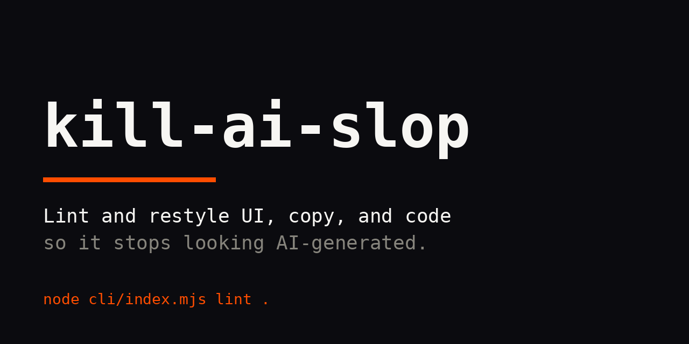
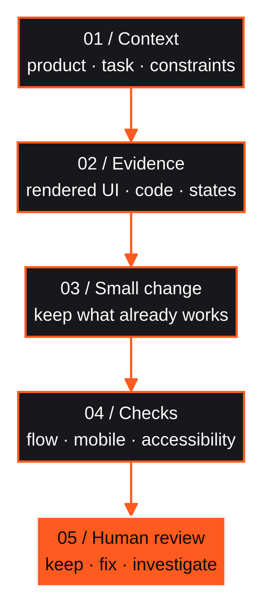
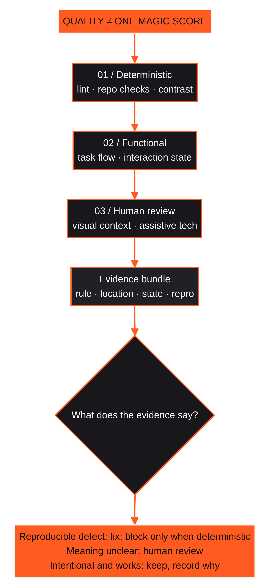

# Kill AI Slop

[Indonesia](README.md) · [English](README.en.md)

[](https://github.com/dikaofcx/kill-ai-slop/actions/workflows/ci.yml)

An agent toolkit for finding and fixing generic UI, copy, and front-end decisions—with evidence, not design-trend bingo. It includes a core skill, five specialist skills, plugin adapters, a dependency-free CLI, and an evaluation harness.

> A lint warning is a nudge to look closer, not a design-court verdict. Don't blow up a working brand just because it uses three cards or a purple gradient.

## Install the skill in under a minute

Requires Node.js 20.12 or newer. Installing the skill does not require `npm ci`.

```sh
git clone --depth 1 https://github.com/dikaofcx/kill-ai-slop.git
cd kill-ai-slop
node cli/index.mjs init --agent claude --global --dry-run
node cli/index.mjs init --agent claude --global
```

Replace `claude` with the client you use. Remove `--global` to install only in the current repository. Review the `--dry-run` output first; continue only if the target directory is right.

If it genuinely helps, [star the repo on GitHub](https://github.com/dikaofcx/kill-ai-slop) so others can find it. Found a false positive or broken adapter? [Open an issue](https://github.com/dikaofcx/kill-ai-slop/issues) with a short example and the client name.


*Diagram source: [Mermaid file](assets/quality-loop.mmd).*

## Quick start

Requires Node.js 20.12 or newer.

```sh
npm ci
npm run ci
node cli/index.mjs list
node cli/index.mjs lint src --format text
node cli/index.mjs contrast "#0B0B0F" "#F7F6F3"
```

All built-in rules are **advisory warnings**. If lint flags something, inspect the context first—it is not a catastrophe, and the command still exits successfully. Want lint as a quality gate? Choose `--strict`, `--max-warnings N`, or an explicit severity in `.killslop.json`.

```sh
node cli/index.mjs lint src --format github --max-warnings 10
node cli/index.mjs lint src --strict
```

See [GUIDE.md](GUIDE.md) for JSON output, GitHub Actions annotations, suppressions, configuration, and heuristic limits.

## Install a skill

```sh
node cli/index.mjs init --agent claude --dry-run
node cli/index.mjs init --agent claude
node cli/index.mjs init --agent all --dry-run
```

Or choose a target folder yourself:

```sh
node cli/index.mjs install --target ./.agents/skills --dry-run
node cli/index.mjs install --target ./.agents/skills
```

The installer checks for conflicts, rejects symlinks in the target path, and will not silently overwrite a different file. Use `--replace` (alias `--force`) only when you choose to; the old file gets a uniquely named backup.

## What's inside



*Diagram source: [Mermaid file](assets/harness-layers.mmd).*

- **Core:** [SKILL.md](SKILL.md), procedures in [agents.md](agents.md), pattern guidance in [skills.md](skills.md), and visual principles in [soul.md](soul.md).
- **Five specialist skills:** UI, copy, mobile, accessibility, and code implementation under [`skills/`](skills/).
- **CLI:** linting, a Claude Code hook, agent installation, rule listing, and contrast checking.
- **Harness:** CLI/rule tests, positive and negative fixtures, repository checks, 16 manual behavior scenarios, and browser checks for responsive screenshots and one interaction state.
- **Adapters:** Agents, Claude Code, Cline, Codex, Cursor, Kimi, Oh My Pi, and Qoder.
- **References:** [UI sources](skills/kill-ai-slop-ui/references/sources.md), [CSS token template](skills/kill-ai-slop-ui/references/tokens-template.css), logo, and diagrams.

The canonical skill sources are four root files. After changing them, run `npm run sync-skills`; do not edit generated copies directly.

## 2026 research: signals, not verdicts

- A blind 2026 study with 92 participants found AI prototypes could score well on pragmatic qualities, while originality/novelty was more often neutral or negative. The sample was small and mostly computer-science students, so don't assume every AI UI is bad—or that every conventional pattern is slop. [SEMISH 2026 study](https://sol.sbc.org.br/index.php/semish/article/view/43563)
- [W3C ACT Rules Format 1.1](https://www.w3.org/TR/act-rules-format/) (2026) calls for clear applicability, assumptions, and limits. When a machine cannot determine context, “needs review” is more honest than a forced verdict.
- [NIST AI 200-3](https://nvlpubs.nist.gov/nistpubs/ai/NIST.AI.200-3.pdf) (September 2026) describes layered evaluation through model testing, red teaming, and user testing. That is why this harness separates lint signals, task/function checks, and human review instead of inventing one magic “slop score.”
- The [Web Almanac 2025 Performance chapter](https://almanac.httparchive.org/en/2025/performance), published in January 2026 with primary data from July 2025, reports that 48% of mobile sites and 56% of desktop sites passed all three Core Web Vitals. That is population context, not a hard target for every product.

For accessibility, the stable target here is [WCAG 2.2](https://www.w3.org/TR/WCAG22/). W3C explains that conformance evaluation combines automated and human evaluation; a clean scan does not prove the whole product conforms or is easy to use. [W3C conformance guidance](https://www.w3.org/WAI/WCAG22/Understanding/conformance)

## A harness without a magic “slop score”

- **Lint and repository checks** catch source patterns and regressions that can be tested deterministically. Lint findings stay advisory unless a project chooses its own quality gate.
- **Task/function cases** check scope, state, keyboard, mobile, and whether changes preserve what must keep working.
- **Human review** evaluates visual context, perception, and assistive-technology experience that cannot be decided from regexes or an initial screenshot.

`npm run check` validates structure and category coverage in [evals/cases.json](evals/cases.json); it does **not** run a model, axe, or user tests. Run the browser suite with `npm run test:browser`; it captures screenshots at 360/768/1440 px, checks horizontal overflow, and tests one menu pattern. Read the [evaluation protocol](evals/README.md) and [browser guide](evals/browser/README.md): screenshots need human review, and results are neither a score nor accessibility certification. Keep conformance/accessibility, task quality, performance, and visual perception separate.

## Hook and plugins

The Claude Code `PostToolUse` hook adds findings as context and always exits with status 0—heuristics must not block the work. The hook protocol has been tested with simulated input, but not verified in a live Claude Code session.

Adapter manifests live in `.agents/plugins/`, `.claude-plugin/`, `.cline-plugin/`, `.codex-plugin/`, `.cursor-plugin/`, `.kimi-plugin/`, `.omp-plugin/`, and `.qoder-plugin/`. This repo has not been published to a marketplace or npm, and its integration paths have not been tested on every agent-client version.

The example client commands below are retained from the source package. Check each client's official docs if a command changes; the account running it needs access to this repo.

```text
# Claude Code
/plugin marketplace add https://github.com/dikaofcx/kill-ai-slop
/plugin install kill-ai-slop@kill-ai-slop

# Kimi Code
/plugins install https://github.com/dikaofcx/kill-ai-slop
```

```sh
# Codex
codex plugin marketplace add dikaofcx/kill-ai-slop
codex plugin add kill-ai-slop@kill-ai-slop

# Cursor agent CLI
agent plugin marketplace add https://github.com/dikaofcx/kill-ai-slop

# Cline CLI
cline plugin install https://github.com/dikaofcx/kill-ai-slop.git

# Oh My Pi
omp plugin marketplace add dikaofcx/kill-ai-slop

# Pi
pi install git:github.com/dikaofcx/kill-ai-slop
```

Want a local install without a marketplace flow? Run `node cli/index.mjs init --agent <name> --dry-run` first, then review the planned file changes.

## Verification and contribution

```sh
npm ci
npm run ci
npm --prefix cli test
node cli/index.mjs lint cli/test/fixtures/slop.html --format json
```

CI checks Ubuntu, Windows, and macOS with Node 20.12 and 22. Visual and accessibility reviews still need to happen in the target project—the linter does not render pages, so don't expect it to judge the interface from source code alone.

Read [GUIDE.md](GUIDE.md) for command contracts, then [CONTRIBUTING.md](CONTRIBUTING.md), [SECURITY.md](SECURITY.md), [CODE_OF_CONDUCT.md](CODE_OF_CONDUCT.md), and [ROADMAP.md](ROADMAP.md) for contribution and project plans.
