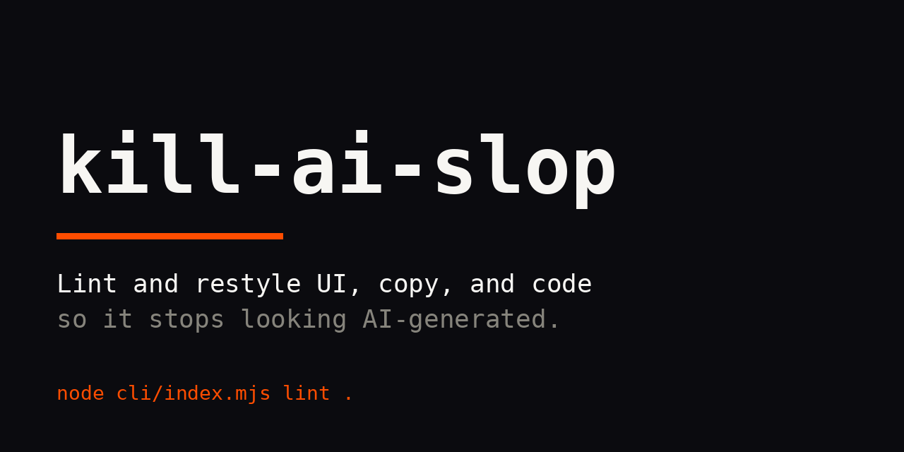
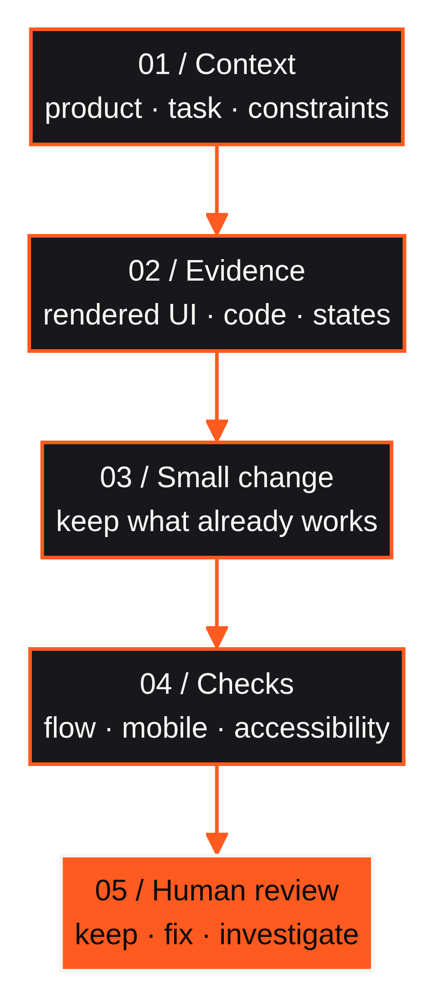
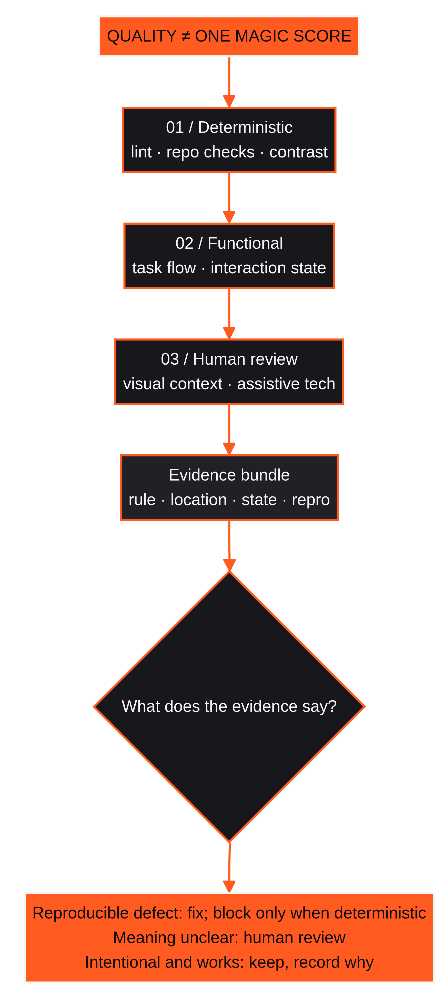

# Kill AI Slop

[Indonesia](README.md) · [English](README.en.md)

[](https://github.com/dikaofcx/kill-ai-slop/actions/workflows/ci.yml)

Toolkit agent buat nemuin dan benerin keputusan UI, copy, dan front-end yang generik—pakai bukti, bukan sekadar ikut tren desain. Isinya skill inti, lima skill spesialis, adapter plugin, CLI tanpa dependency runtime, dan harness evaluasi.

> Warning linter itu alarm kecil buat ngecek, bukan surat tilang desain. Jangan sok-sokan ngerombak brand yang udah bekerja cuma gara-gara ada tiga kartu atau gradien ungu.

## Pasang skill dalam semenit

Butuh Node.js 20.12 atau lebih baru. Instal skill tidak perlu `npm ci`.

```sh
git clone --depth 1 https://github.com/dikaofcx/kill-ai-slop.git
cd kill-ai-slop
node cli/index.mjs init --agent claude --global --dry-run
node cli/index.mjs init --agent claude --global
```

Ganti `claude` dengan client yang kamu pakai. Hapus `--global` kalau pemasangannya cuma untuk repo ini. Cek hasil `--dry-run` dulu; lanjutkan hanya kalau folder targetnya benar.

Kalau memang kepake, [kasih star di GitHub](https://github.com/dikaofcx/kill-ai-slop) biar orang lain lebih gampang nemuin. Ketemu false positive atau adapter rusak? [Buka issue](https://github.com/dikaofcx/kill-ai-slop/issues) dengan contoh singkat dan nama client-nya.



*Diagram dibuat dari [source Mermaid](assets/quality-loop.mmd).*

## Mulai cepat

Butuh Node.js 20.12 atau lebih baru.

```sh
npm ci
npm run ci
node cli/index.mjs list
node cli/index.mjs lint src --format text
node cli/index.mjs contrast "#0B0B0F" "#F7F6F3"
```

Semua rule bawaan berstatus **warning advisory**. Kalau lint nemu sesuatu, cek konteksnya dulu—bukan kiamat, dan command tetap jalan. Mau menjadikannya quality gate? Pilih `--strict`, `--max-warnings N`, atau severity eksplisit di `.killslop.json`.

```sh
node cli/index.mjs lint src --format github --max-warnings 10
node cli/index.mjs lint src --strict
```

Output JSON, anotasi GitHub Actions, suppression, konfigurasi, dan batas heuristik dibahas di [GUIDE.md](GUIDE.md).

## Pasang skill

```sh
node cli/index.mjs init --agent claude --dry-run
node cli/index.mjs init --agent claude
node cli/index.mjs init --agent all --dry-run
```

Atau tentukan folder tujuan sendiri:

```sh
node cli/index.mjs install --target ./.agents/skills --dry-run
node cli/index.mjs install --target ./.agents/skills
```

Installer ngecek konflik, nolak symlink di jalur target, dan nggak diam-diam nimpa file yang beda. Pakai `--replace` (alias `--force`) hanya kalau memang kamu pilih; file lama dicadangkan dengan nama unik.

## Isi toolkit



*Diagram dibuat dari [source Mermaid](assets/harness-layers.mmd).*

- **Core:** [SKILL.md](SKILL.md), prosedur di [agents.md](agents.md), panduan pola di [skills.md](skills.md), dan prinsip visual di [soul.md](soul.md).
- **Lima skill spesialis:** UI, copy, mobile, aksesibilitas, dan implementasi kode di [`skills/`](skills/).
- **CLI:** lint, hook Claude Code, installer agent, daftar rule, dan pemeriksa kontras.
- **Harness:** tes rule/CLI, fixture positif-negatif, repo checks, 16 skenario evaluasi manual, dan suite browser untuk screenshot responsif serta satu state interaksi.
- **Adapter:** Agents, Claude Code, Cline, Codex, Cursor, Kimi, Oh My Pi, dan Qoder.
- **Referensi:** [sumber UI](skills/kill-ai-slop-ui/references/sources.md), [template token CSS](skills/kill-ai-slop-ui/references/tokens-template.css), logo, dan diagram.

Kalau mengubah empat sumber skill di root, jalankan `npm run sync-skills`; jangan edit salinan generated langsung.

## Riset 2026: sinyal, bukan vonis

- Studi blind 2026 terhadap 92 peserta menemukan prototipe AI bisa dinilai baik secara pragmatis, sementara originality/novelty lebih sering netral atau negatif. Sampelnya kecil dan didominasi mahasiswa ilmu komputer, jadi jangan sok menyimpulkan semua UI AI jelek—atau semua pola konvensional itu slop. [Studi SEMISH 2026](https://sol.sbc.org.br/index.php/semish/article/view/43563)
- [W3C ACT Rules Format 1.1](https://www.w3.org/TR/act-rules-format/) (2026) mendorong aturan yang jelas soal applicability, asumsi, dan batasnya. Kalau mesin belum bisa memastikan konteks, hasil review lebih jujur daripada maksa vonis.
- [NIST AI 200-3](https://nvlpubs.nist.gov/nistpubs/ai/NIST.AI.200-3.pdf) (September 2026) membahas evaluasi berlapis lewat model testing, red teaming, dan user testing. Makanya harness di sini misahin sinyal linter, fungsi/tugas, dan review manusia—nggak dijadiin satu “skor slop” ajaib.
- [Web Almanac 2025: Performance](https://almanac.httparchive.org/en/2025/performance), terbit Januari 2026 dengan data utama Juli 2025, melaporkan 48% situs mobile dan 56% desktop lolos ketiga Core Web Vitals. Itu konteks populasi, bukan target saklek yang otomatis cocok buat semua produk.

Untuk aksesibilitas, target stabil yang dipakai adalah [WCAG 2.2](https://www.w3.org/TR/WCAG22/). W3C menjelaskan bahwa evaluasi conformance menggabungkan otomasi dan penilaian manusia; scan bersih bukan bukti seluruh produk patuh atau gampang dipakai. [Panduan conformance W3C](https://www.w3.org/WAI/WCAG22/Understanding/conformance)

## Harness tanpa “skor slop” ajaib

- **Lint dan repo checks** menangkap pola source code dan regresi yang bisa diuji deterministik. Temuan linter tetap advisory kecuali proyek memilih quality gate sendiri.
- **Kasus fungsi/tugas** memeriksa scope, state, keyboard, mobile, dan apakah perubahan mempertahankan hal yang harus tetap bekerja.
- **Review manusia** menilai konteks visual, persepsi, dan pengalaman assistive technology yang tidak bisa diputuskan dari regex atau screenshot awal.

`npm run check` memvalidasi struktur dan cakupan kategori di [evals/cases.json](evals/cases.json); ia **tidak** menjalankan model, axe, atau user test. Suite browser dapat dijalankan lewat `npm run test:browser`; ia menangkap screenshot pada 360/768/1440 px, memeriksa overflow horizontal, dan menguji satu pola menu. Baca [protokol evaluasi](evals/README.md) dan [panduan browser](evals/browser/README.md): screenshot perlu ditinjau manusia dan hasilnya bukan skor atau sertifikasi aksesibilitas. Pisahkan conformance/accessibility, task quality, performa, dan persepsi visual.

## Hook dan plugin

Hook Claude Code `PostToolUse` menambahkan temuan sebagai konteks dan selalu keluar dengan status 0—heuristik nggak boleh ngeblokir kerjaan. Protokol hook sudah dites dengan input simulasi, tapi belum diverifikasi di sesi Claude Code live.

Manifest adapter ada di `.agents/plugins/`, `.claude-plugin/`, `.cline-plugin/`, `.codex-plugin/`, `.cursor-plugin/`, `.kimi-plugin/`, `.omp-plugin/`, dan `.qoder-plugin/`. Repo ini belum diterbitkan ke marketplace atau npm, dan jalur integrasinya belum dites di semua versi client agent. Repository ini publik untuk dibaca; penggunaan fitur atau layanan client tetap mengikuti izin dan konfigurasi masing-masing.

Contoh perintah di bawah dipertahankan dari paket sumber dan belum diuji di semua versi client. Repo ini dapat diakses publik dari GitHub; ketersediaan plugin tetap bergantung pada dukungan serta konfigurasi client. Cek dokumentasi resmi client kalau command berubah.

```text
# Claude Code
/plugin marketplace add https://github.com/dikaofcx/kill-ai-slop
/plugin install kill-ai-slop@kill-ai-slop

# Kimi Code
/plugins install https://github.com/dikaofcx/kill-ai-slop
```

```sh
# Codex
codex plugin marketplace add dikaofcx/kill-ai-slop
codex plugin add kill-ai-slop@kill-ai-slop

# Cursor agent CLI
agent plugin marketplace add https://github.com/dikaofcx/kill-ai-slop

# Cline CLI
cline plugin install https://github.com/dikaofcx/kill-ai-slop.git

# Oh My Pi
omp plugin marketplace add dikaofcx/kill-ai-slop

# Pi
pi install git:github.com/dikaofcx/kill-ai-slop
```

Mau pasang lokal tanpa flow marketplace? Jalankan `node cli/index.mjs init --agent <name> --dry-run` dulu, terus periksa rencana file-nya.

## Verifikasi dan kontribusi

```sh
npm ci
npm run ci
npm --prefix cli test
node cli/index.mjs lint cli/test/fixtures/slop.html --format json
```

CI menguji Ubuntu, Windows, dan macOS dengan Node 20.12 serta 22. Cek visual dan aksesibilitas tetap harus dilakukan di proyek target—linter nggak merender halaman, jadi jangan ngaku bisa menilai tampilan dari kode doang.

Baca [GUIDE.md](GUIDE.md) untuk kontrak command, lalu [CONTRIBUTING.md](CONTRIBUTING.md), [SECURITY.md](SECURITY.md), [CODE_OF_CONDUCT.md](CODE_OF_CONDUCT.md), dan [ROADMAP.md](ROADMAP.md) untuk kontribusi dan rencana proyek.
