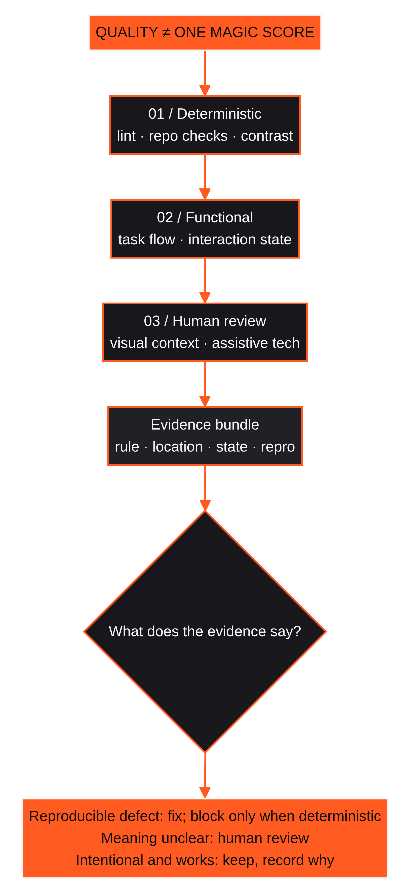

# Behavioral regression cases

`cases.json` berisi 16 skenario regresi manual. Isinya menguji keputusan berbasis konteks, termasuk hard negative: pola visual yang memang disengaja, scan yang belum lengkap, dan state yang belum diperiksa. Ini bukan skor estetika dan bukan detektor asal-usul AI.

`npm run check` memvalidasi struktur, ID, tag, dan cakupan kategori. Ia **tidak** menjalankan model, memeriksa screenshot, menjalankan axe, atau menilai jawaban. Jangan laporkan kasus manual sebagai lulus kalau belum benar-benar dijalankan.

## Cara menjalankan review

1. Pakai prompt dan konteks dari satu kasus pada sesi baru dengan skill/versi yang sedang diuji.
2. Nilai setiap butir `must` dan `mustNot` berdasarkan perilaku yang terlihat. Simpan kutipan atau bukti, bukan impresi umum.
3. Catat commit, model/tool dan versi, tanggal, reviewer, viewport, state, serta file/artefak yang diuji.
4. Jika hasilnya gagal, tambahkan konteks yang relevan. Jangan mengubah rubric cuma supaya implementasi yang sekarang terlihat lolos.

## Pisahkan hasilnya

- **Conformance/accessibility:** catat rule, kriteria WCAG, elemen/state, bukti, dan status `pass`, `fail`, `inapplicable`, atau `needs-human-review`. W3C menjelaskan bahwa conformance testing menggabungkan otomatisasi dan evaluasi manusia; scan bersih bukan sertifikat [kepatuhan WCAG](https://www.w3.org/WAI/WCAG22/Understanding/conformance).
- **Fungsi/tugas:** catat tugas, penyelesaian, error, dan state yang dicoba. Jangan mengklaim keyboard, dialog, atau screen reader sudah diuji dari screenshot awal.
- **Persepsi visual:** pakai review buta bila membandingkan variasi, dan pisahkan kualitas pragmatis dari originality/novelty. Studi prototipe 2026 yang relevan hanya melibatkan 92 peserta dan bukan produk live, jadi jangan digeneralisasi ke semua pengguna atau model ([studi SEMISH 2026](https://sol.sbc.org.br/index.php/semish/article/view/43563)).
- **Performa:** simpan LCP/INP/CLS dan metode lab/field secara terpisah. TBT lab adalah proxy INP, bukan penggantinya; angka satu run bukan klaim pengalaman produksi.

Jangan gabungkan semua dimensi menjadi satu “slop score” kecuali ada bobot dan validasi yang jelas. Untuk aturan otomatis, definisikan applicability dan batasnya secara objektif; panduan [W3C ACT Rules Format 1.1](https://www.w3.org/TR/act-rules-format/) membedakan hasil yang lolos, gagal, atau tidak berlaku dan meminta asumsi/limitasi dicatat. Lihat juga panduan evaluasi berlapis [NIST AI 200-3](https://nvlpubs.nist.gov/nistpubs/ai/NIST.AI.200-3.pdf).

## Mengubah kasus

1. Jelaskan kasus mana yang berubah dan kenapa.
2. Tambahkan kasus untuk regresi nyata atau false positive yang ditemukan, bukan variasi kosmetik dari prompt yang sama.
3. Pastikan `must` menjelaskan perilaku yang dapat diamati dan `mustNot` menangkap kesalahan mahal.
4. Pertahankan kasus yang sengaja menguji pilihan desain yang sah. Jangan mengubahnya jadi pola terlarang hanya karena linter bisa mendeteksinya.
5. Setelah perubahan, jalankan `npm run ci`.

## Pemeriksaan browser

Suite Playwright opsional di [browser/README.md](browser/README.md) menangkap screenshot pada lebar 360, 768, dan 1440 CSS px, memeriksa overflow horizontal halaman, dan menguji satu pola menu keyboard/pointer pada fixture. Jalankan `npm run test:browser` setelah memasang browser Chromium. Suite ini tidak membandingkan screenshot terhadap baseline, tidak memindai seluruh aksesibilitas, dan tidak memberi skor kualitas; screenshot tetap perlu ditinjau manusia. Untuk proyek lain, arahkan `EVAL_BASE_URL` ke halaman lokal/staging yang memang dikuasai dan sesuaikan selector serta ekspektasi interaksi. Fixture CI hanya memverifikasi harness, bukan kualitas produk.
